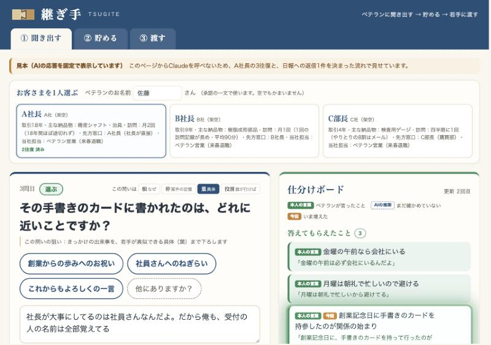

# 継ぎ手（TSUGITE）

**誰の：** 地方の中小メーカーで、ベテラン営業の引退を迎える会社の。
**どの問題を：** お客さまとの関係の作り方（会える曜日、話の入り方、気遣い、誰が行けば話が通るか）が、記録に残らないまま消えていく問題を。
**何で：** ページから Claude を呼ぶ、claude.ai のアーティファクト1枚で。
**どう解決するか：** ベテランに選択肢つきの問いで「聞き出し」、本人の言葉で仕分けて「貯め」、若手の日報には答えを渡しきらず先輩の物語で「渡す」。

> 記録を読むAIではなく、記録の行間を聞きに行くAI。

---

## 3つのタブ

| タブ | すること |
|---|---|
| ① 聞き出す | お客さまカード（SFA・顧客台帳の記録だけ。見本のA・B・Cのほか、4枚目で自分のお客さまの記録も入れられる）から AI が仮説を立て、YES/NO か選択肢で聞く。答えるたびに右の「仕分けボード」が更新され、本人の言葉（緑）と AI の推測（点線）と、まだのこと（橙）に分かれる。各問いには札（確かめる・選ぶ・噛み砕く・プラスα・承認・最後のひと押し）と、問いの4層（根・幹・葉・役割）、「この問いの狙い」が出る |
| ② 貯める | 聞き出した本人の言葉が、お客さまごとの引き継ぎカードに、4層で並ぶ（保存はしない） |
| ③ 渡す | 若手の日報に「受け止める → 先輩の物語 → 締め」で返す。締めは「問い」「承認・励まし」「意識する一点」のどれか。物語は引き継ぎカードにある本人の言葉だけで作る |

聞き方の作法：基本は YES/NO か選択肢（違っていれば、人はつい話してくれる）／広い質問は最後の1回だけ／承認は2〜3回に1回で、事実だけの答えでは承認しない／抽象的な答えには噛み砕く問い／仮説がはずれて言い直してくれたら、すぐ選択肢を出さず「プラスαでできることは？」と考える機会をつくる（思いつかなければ例を出し、良い考えが出たら承認する）。

## 試し方
1. 公開ページ（https://claude.ai/artifact/9xQxff771nY6EDbJKaEvEP）を開く（claude.ai にサインインしている必要がある）。初回だけ「Claude を使用」の許可を求められる。
2. ①でお客さまカードを1枚選び、答え欄に話して入れる（Mac：音声入力キー／Windows：Windowsキー＋H／iPhone：キーボードのマイク）。選択肢を押すと答え欄に入り、続けて話して付け足せる。
3. ②で引き継ぎカードを見て、③で「例の日報を入れる」→「先輩として返す」。
4. ご自身の経験で試すときは、①の4枚目「＋ 自分のお客さまで試す」を押し、記録に残る情報（呼び名・取引年数・主な納品物・訪問の頻度・メモ）だけを入れて「この記録で聞き始める」（実名・会社名・連絡先は入れないでください。空欄があっても始められます）。

`index.html` をそのままブラウザで開くと、Claude を呼べないので「見本（AIの応答を固定で表示しています）」と出て、A社長の3往復と日報への返信1件が決まった流れで動く。

## APIキーが要らない理由
画面は claude.ai のアーティファクトとして公開し、ページから Claude を呼ぶ機能（sample）で動かしている。呼び出しは**見ている人自身の Claude** で動くので、このリポジトリにも画面にも APIキーは無い。キーの流出や、費用が暴走する心配がない。Claude は呼び出しのたびに会話を覚えないため、ページが毎回「お客さまカード・これまでのやりとり・仕分けボード・前回の承認からの回数」をまとめて渡している。承認の間隔や最後の問いなど、AI に任せると崩れやすい作法は、ページ側でも数えて守っている。

## 検証の結果
| 確かめたこと | 結果 | 記録 |
|---|---|---|
| A社長で通しの聞き取り（条件1） | 本番の呼び出しで3往復、手元で8往復を2回。毎回ボードが更新され、選択肢つきの次の一問が出た。抽象的な答えには噛み砕く問い、承認は2〜3回に1回、広い質問は最後の1回だけ | [evals/joken1-A-8ofuku.md](evals/joken1-A-8ofuku.md) |
| 日報10件への返信（条件3） | 10件中10件が、答えを言い切らず、締めが3種のどれか（問い4・承認・励まし3・意識する一点3）。引用はすべて引き継ぎカードどおり | [evals/nippo-10.md](evals/nippo-10.md) |
| 聞き出す10件の仕分け | 仕分け：10件中10件が一致（作り手も10件〇）。次の問い：1回目は作り手の確認で〇7・△2・×1。作り手の考えを指示文に入れて流し直すと、×・△の3件はすべて考えどおりになった。承認の決まりも直した3回目では、承認の付き方も案どおり（仕分けは3回とも10件一致） | [evals/kikidasu-10.md](evals/kikidasu-10.md) |
| 各端末で崩れない（条件2） | アプリ内ブラウザのパソコン幅・スマホ幅（375px）では崩れなし。Mac Chrome/Safari・Windows Chrome/Edge・iPhone の実機は未確認 | — |
| GitHub と公開版が同じ（条件4） | 公開版は最新の index.html から出している。push 後に照合する（未確認） | — |

## 作り手について
作り手はエンジニアではない。営業と人材育成の現場にいる人間が、自分の現場の知識で、Claude Code と一緒に作った。コードは Claude Code が書き、作り手は「何をどう聞けば、ベテランは話してくれるか」を決めた。決めたことと、行ったり来たりした経緯は [decision.md](decision.md) にある。

## このリポジトリにあるもの
- `index.html`：画面（3タブ）
- `kikidasu_prompt_v1.md`：聞き出す AI への指示文と検証用の10件
- `skills/`：使っている公開版スキル2本（tsugite-kizukai-lite：気遣いの考え方／tsugite-zero-stress-lite：押さない営業の語り口）
- `evals/`：検証の結果
- `decision.md`：決めたことの記録／`CLAUDE.md`：約束ごと（実名を入れない、完全版を入れない、色、改行）
- `screenshots/`：画面の画像
- デモの会社・人物（みなと精工、A社長・B社長・C部長）はすべて架空。

---

## English summary
**TSUGITE** ("joint" — the Japanese carpentry technique of joining two pieces of wood) helps small regional manufacturers pass on what veteran salespeople know but never wrote down: when a client can be met, how to open a conversation, the small courtesies, and who actually needs to be in the room. It runs as a single claude.ai artifact that calls Claude from the page, so it needs no API key — each viewer's own Claude does the work. Tab 1 **draws out** knowledge: starting from CRM-style records only, Claude asks yes/no or multiple-choice questions, breaks down abstract answers, acknowledges the veteran every two to three turns, and sorts each answer live into the veteran's own words, AI guesses, and what is still unknown. Tab 2 **stores** it as a hand-off card per client. Tab 3 **hands it over**: replies to a junior's daily report with a short story in the veteran's own words, ending in a question, encouragement, or one thing to keep in mind — never the full answer. Built by a non-engineer with Claude Code. All companies and people in the demo are fictional.
